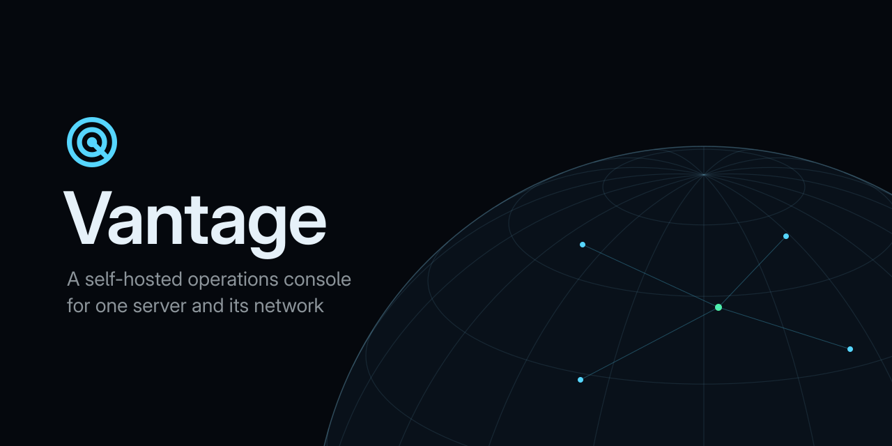
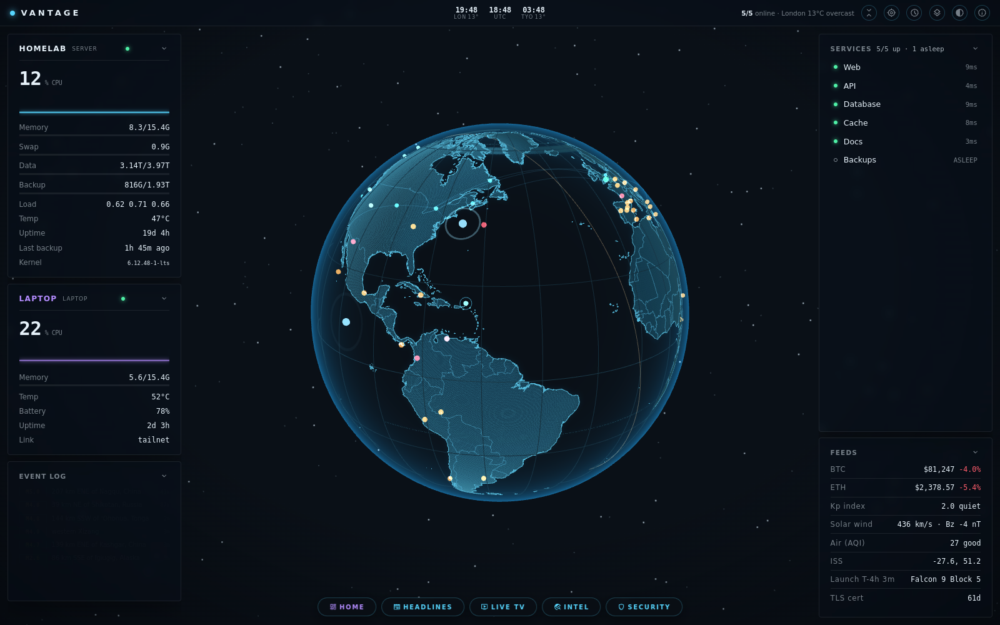
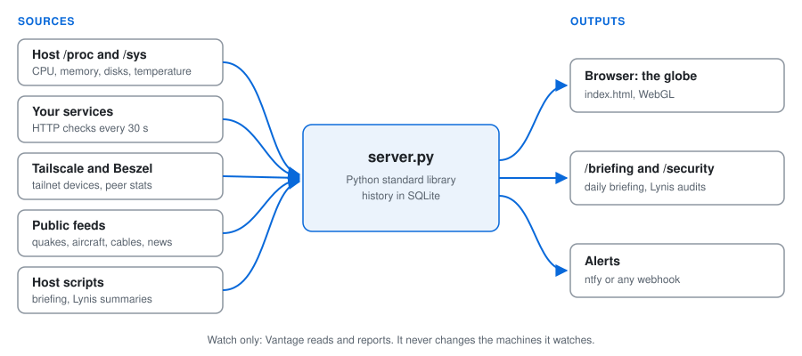
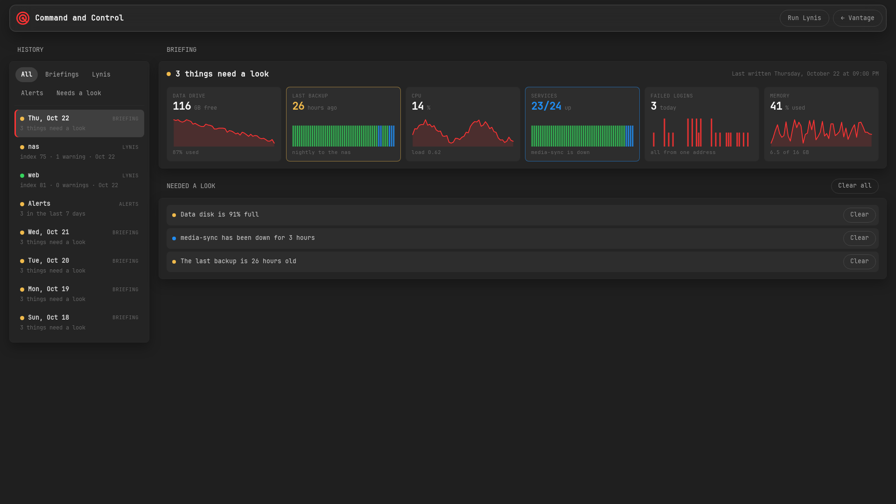
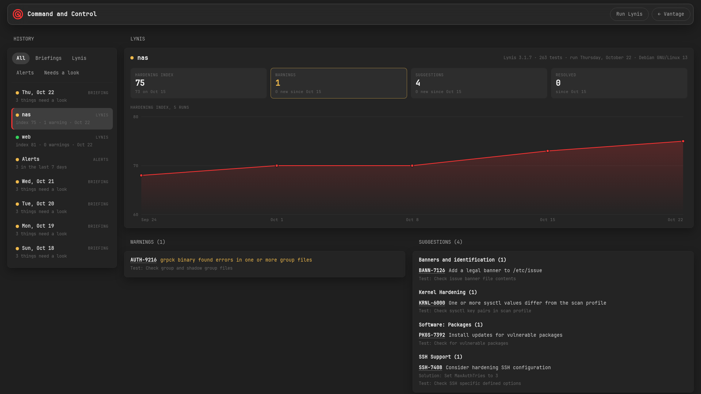

<p align="center"></p>

[](https://github.com/zakijss/Vantage/actions/workflows/ci.yml)
[](https://github.com/zakijss/Vantage/releases)
[](https://github.com/zakijss/Vantage/pkgs/container/vantage)
[](LICENSE)

# Vantage

Vantage is a watch-only operations console for one self-hosted server and the
devices around it. It probes your services, shows the host's CPU, memory,
disks and temperature beside a WebGL globe, and layers public data feeds
(earthquakes, aircraft, cables, outages and more) over the map. It checks,
alerts and tells you. It never starts, stops or changes anything on the
machines it watches.



The backend is one Python process using only the standard library. The page
loads Three.js and a few small helpers from public CDNs (unpkg, jsDelivr). There
is nothing to build.

## Run with Podman or Docker

Each release publishes an image for amd64 and arm64:

```sh
podman run --rm -p 8106:8106 -e DASH_TOKEN="$(openssl rand -hex 24)" ghcr.io/zakijss/vantage:1
```

Or build it yourself:

```sh
podman build -t vantage .
podman run --rm -p 8106:8106 -e DASH_TOKEN="$(openssl rand -hex 24)" vantage
```

Open <http://127.0.0.1:8106/> and log in with the token. With Docker, use
`docker build -f Containerfile -t vantage .` and the same `run` line.

This runs on the default settings, with no host stats and no services of your
own. For those, use Compose, which mounts the host's `/sys` and `/proc` and
your config:

```sh
DASH_TOKEN="$(openssl rand -hex 24)" docker compose up -d --build
```

Copy `config.example.json` to `config.json`, edit it and uncomment its line in
`compose.yaml` to watch your own services. The image runs as an unprivileged
user (uid 10001) and keeps its history in the `vantage-state` volume. The rest
of the routes are under [Quick start](#quick-start).

## What it shows

- Service checks every 30 seconds, with uptime and latency history. With
  `constellation` on, each service is also a node orbiting the server above
  the globe. A service started on demand can read as asleep when its port is
  closed, instead of down.
- Host telemetry from `/proc` and `/sys`: CPU, memory, swap, load,
  temperature, network throughput, disk use with a growth rate and days until
  full, and the age of the newest file in your backup folder.
- One peer device, such as a laptop: CPU, memory, temperature and battery.
  Either `agent.py` on the device pushes them, or Vantage reads them from a
  [Beszel](https://beszel.dev) hub that already monitors it (`beszel.py`).
- Map layers from keyless public sources: day and night, submarine cables,
  earthquakes, GDACS disaster alerts, wildfires, volcanoes, icebergs, tropical
  cyclones, the aurora oval, aircraft (OpenSky), satellites (CelesTrak),
  precipitation radar, Environment Canada weather alerts, WHO outbreak news,
  internet outages (IODA), NASA imagery and strategic points. Expensive layers
  are only fetched while a browser has them switched on.
- A world panel (ISS, Kp index, solar wind, air quality, next launch), world
  headlines, per-country news on click, and clocks with weather for cities you
  pick.
- The INTEL panel: your attack surface (what Shodan has seen on your home IP,
  your tailnet's machine names in certificate-transparency logs, sockets
  listening beyond loopback, Tailscale Serve and Funnel, tailnet device keys),
  optional checks of your own domains, flights overhead or by tail number
  (adsb.lol), and image checks (EXIF and GPS, sun position, reverse
  geocoding).
- Threat intelligence matched to the software you run (CISA's Known Exploited
  Vulnerabilities catalogue), and optional breach checks for your own
  addresses.
- History in SQLite, and alerts on change (a service down for 10 minutes, a TLS
  certificate near expiry, a stale backup, a full disk, new exposure or threat
  findings) to ntfy or any webhook.
- A daily briefing and a security page at `/briefing` and `/security`, fed by
  files your own scripts write: a status summary, and each host's weekly
  [Lynis](https://cisofy.com/lynis/) audit with the last week's security
  alerts.

## How it works



`server.py` polls each source on its own timer, keeps history in SQLite under
`STATE_DIR` and serves JSON to the pages. The globe and its layers are drawn in
the browser. Anything that needs root or the host's network, such as Lynis
reports or the tailnet's sockets, comes in as files your own scripts write
(see [Feeding it from the host](#feeding-it-from-the-host)).

## Requirements

- Linux. Host telemetry reads `/proc` and `/sys`.
- Python 3.11 or newer with no extra packages, or Podman or Docker to run the
  container (`python:3.15.0-slim-trixie`).
- A browser with WebGL, and internet access from the server for the public
  feeds and from the browser for the CDN scripts.
- Optional: Tailscale, for private remote access and token-free login from
  your own devices (see [Security model](#security-model)).

## Quick start

Every route below needs a `DASH_TOKEN`; Vantage refuses to start without one.
Generate it once and keep it in a secrets file:

```sh
git clone <this repo> vantage && cd vantage
cp config.example.json config.json            # then edit it
printf 'DASH_TOKEN=%s\n' "$(openssl rand -hex 24)" > secrets.env
```

### Docker Compose or podman-compose

```sh
docker compose --env-file secrets.env up -d --build
```

`compose.yaml` builds the image from `Containerfile`, runs it on host
networking so the service checks reach ports published on the host's
`127.0.0.1`, keeps Vantage itself on `127.0.0.1:8106` and keeps state in the
named volume `vantage-state`. `--env-file` supplies `DASH_TOKEN`; uncomment
the `env_file` line if `secrets.env` holds other secrets as well, and the
`config.json` line to mount your config read-only. Mount each disk you list
under `disks` read-only at the path you gave it; the file has a commented
example.

### Podman Quadlet (rootless)

This runs the stock Python image with the code mounted read-only, so updating
is a file copy:

```sh
mkdir -p ~/vantage ~/vantage-state
cp *.py index.html briefing.html config.json secrets.env ~/vantage/ && cp -r static ~/vantage/
cp deploy/vantage.container.example ~/.config/containers/systemd/vantage.container
systemctl --user daemon-reload && systemctl --user start vantage.service
```

The unit uses `Network=slirp4netns:allow_host_loopback=true`, which lets the
container reach services published on the host's `127.0.0.1` as `10.0.2.2`.
Without it every service reads as down. To use the built image instead, run
`podman build -t vantage .`, set `Image=localhost/vantage`, and mount only
`config.json` (and `acks.json`) into `/app`.

### Plain Python

```sh
set -a; . ./secrets.env; set +a
STATE_DIR=./state HOST_SYS=/sys HOST_PROC=/proc BIND=127.0.0.1 python3 server.py
```

Then open <http://127.0.0.1:8106/>. On the host, Vantage finds your services
on `127.0.0.1`.

### A peer device

On a laptop or other device, run `agent.py` with `DASH_URL` (Vantage's
`/api/push`), `DASH_NAME` (the config's `peer.name`) and the same
`DASH_TOKEN`. `deploy/vantage-agent.container.example` does this as a Quadlet.

If Beszel already monitors the device, run nothing on it. Give the peer a
`beszel` entry in the config and put a Beszel user with the `readonly` role
that can see that system in `DASH_BESZEL_USER` and `DASH_BESZEL_PASSWORD`.
Vantage then reads the device from the hub every 10 seconds.

## Configuration

Settings live in one JSON file: `VANTAGE_CONFIG`, or `config.json` beside
`server.py`. `config.example.json` sets nearly every key. Every key is
optional; with no file, Vantage starts with no services, one disk (`/`) and no
home location.

Vantage checks the file at start-up. A wrong type, an unknown key (usually a
typo) or a service without a `port` stops it with a list of what to fix. Where
a key has an environment variable, the variable wins; list settings take it
comma-separated.

| Key | Environment | Default | What it is |
|---|---|---|---|
| `host` | | `{}` | The server: `name` (its host name, used in findings and to leave it out of the device ring), `label` (shown on the page), `role`, `about`, `wiki`, `github` |
| `peer` | | none | One device whose stats Vantage shows: `name` (as the agent sends it in `DASH_NAME`; required), `label`, `role`, `about`, `wiki`, `github`, and optionally `beszel`: `{"port", "system"}` to read it from a Beszel hub instead of an agent. `port` is the hub's port on the host (8090), `system` its name in Beszel (the peer's `name`) |
| `services` | | `[]` | The services to check, each `{"name", "port", "path", "ok", "public", "host", "url", "on_demand", "desc"}`. `name` and `port` (the local port) are required. `path` defaults to `/`. `ok` lists status codes besides 2xx and 3xx that mean up, such as a login page's 401. `public` is the port the link opens on `host` (default `service_host`); `url` overrides the link. `on_demand` reads a closed port as asleep |
| `service_host` | | `""` | The host name service links use, such as `server.example.ts.net` |
| `gateway_probe_port` | | the first service's port | A port that answers on the host, used to find which gateway address reaches it |
| `origin` | `DASH_ORIGIN` | none | Vantage's own public origin, such as `https://server.example.ts.net:8443`. Requests from it count as Vantage's own pages |
| `owners` | `DASH_TS_USERS` | `[]` | Tailnet logins that need no token, through the Serve socket only |
| `dashboard` | | none | A start page that links here and shows the briefing: `label`, `url`, `title`. Its origin may read and clear the briefing (CORS) |
| `history_link` | | none | A link under the host's charts, such as Beszel: `label`, `url` |
| `home` | | none | `{"name", "code", "lat", "lon", "tz"}`: weather, air quality, the home marker, flights overhead and the first clock. `lat` and `lon` are required |
| `cities` | | none | The default clocks, each `{"n", "name", "tz", "lat", "lon"}` (`n` is a short code). Each browser can change its own |
| `disks` | | `/` as Root | Disks to show, each `{"name", "path"}` |
| `backup_path` | `BACKUP_PATH` | none | A folder whose newest file gives the backup age |
| `cert` | | none | A TLS certificate to count down: `{"host", "port", "label"}`, reached through the host gateway. `port` defaults to 443 |
| `notify_url` | `DASH_NOTIFY_URL` | none | Where alerts go: an ntfy topic URL or any webhook that takes a POST |
| `alert_cert_days` | `DASH_ALERT_CERT_DAYS` | 14 | Alert when the certificate has fewer days left |
| `alert_backup_hours` | `DASH_ALERT_BACKUP_HOURS` | 36 | Alert when the newest backup is older |
| `alert_disk_pct` | `DASH_ALERT_DISK_PCT` | 90 | Alert when a disk is this full |
| `alert_grace_min` | `DASH_ALERT_GRACE_MIN` | 10 | How long a service must stay down before it alerts |
| `acks_file` | `DASH_ACK_FILE` | `acks.json` beside the code | A JSON object of findings you have taken on, `{"start of the finding's text": "who fixes it and how"}`. They stop alerting |
| `retain_days` | `DASH_RETAIN_DAYS` | 30 | Days of samples and events kept |
| `tailnet_domain` | `DASH_TAILNET_DOMAIN` | none | Your tailnet's DNS name (`example.ts.net`), whose machine names are looked up in the certificate logs |
| `exposure_file` | `DASH_EXPOSURE` | `STATE_DIR/exposure.json` | Where the host collector writes (see below) |
| `expected_open` | `DASH_EXPECTED_OPEN` | `22`, `41641` | Ports that may listen beyond loopback and the tailnet |
| `expected_public` | `DASH_EXPECTED_PUBLIC` | none | Ports the internet may reach on your home IP |
| `recon_domains` | `DASH_RECON_DOMAINS` | none | Your own domains to check: DNS, SPF, DMARC, DKIM, certificates |
| `recon_emails` | `DASH_RECON_EMAILS` | none | Your own addresses to check for breaches |
| `threat_watch` | `DASH_THREAT_WATCH` | common self-hosted software | Software names matched against CISA KEV, whole-word |
| `threat_kev_days` | `DASH_THREAT_KEV_DAYS` | 14 | How recently a KEV entry must be added to alert |
| `ransomware_url` | `DASH_RANSOMWARE_URL` | none | A leak-site victim feed, checked for your own domains only |
| `flights_radius_nm` | `DASH_FLIGHTS_RADIUS` | 60 | Radius of the flights-overhead view, in nautical miles |
| `flights_watch` | `DASH_FLIGHTS_WATCH` | none | Tail numbers or hex codes to notify on when airborne |
| `acdb_dir` | `DASH_ACDB_DIR` | `STATE_DIR/acdb` | Where the aircraft-type database is cached |
| `security_dir` | `DASH_SECURITY_DIR` | `STATE_DIR/security` | Where the Lynis summaries and security alerts are |
| `cables_api` | `DASH_CABLES_API` | `https://www.submarinecablemap.com/api/v3` | Where the submarine cable data is fetched from at start-up (see [License](#license)). `""` turns the fetch off; a copy already in `STATE_DIR/cables.json` is still served |
| `scans` | | none | Buttons on the security page that ask the host to run a scan, each `{"id", "label", "about"}`. `id` (a-z, 0-9, `_`, `-`) is required; see [Security page](#security-page) |
| `constellation` | | `false` | `true` draws the services, the peer and the tailnet devices as spheres orbiting a core above the north pole, with a layer toggle to hide them. Off, the page shows the globe alone |

Secrets and runtime settings come from the environment only:

| Variable | Default | What it is |
|---|---|---|
| `DASH_TOKEN` | none | Required. The token for peer pushes and the protected endpoints |
| `DASH_NOTIFY_TOKEN` | none | An access token for an ntfy server that needs a login |
| `DASH_HIBP_KEY` | none | A Have I Been Pwned key for breach checks; without it XposedOrNot is used |
| `DASH_BESZEL_USER`, `DASH_BESZEL_PASSWORD` | none | The read-only Beszel login, for a peer read from Beszel |
| `TAILSCALE_API_KEY` | none | Turns on the tailnet device ring (drawn when `constellation` is on), polled every 90 seconds |
| `VANTAGE_CONFIG` | `config.json` beside the code | The config file. When set, the file must exist |
| `PORT` | 8106 | The TCP port |
| `BIND` | `0.0.0.0` | The address to listen on. Use `127.0.0.1` outside a container |
| `DASH_SERVE_SOCK` | none | A unix socket to listen on as well, for Tailscale Serve |
| `HOST_GW` | tried in turn | The address that reaches the host's loopback ports. Tried before `10.0.2.2`, `host.containers.internal`, `169.254.1.2` and `127.0.0.1` |
| `HOST_SYS`, `HOST_PROC` | `/host/sys`, `/host/proc` | Where the host's `/sys` and `/proc` are mounted |
| `STATE_DIR` | `/state` | Where history and state go |
| `STATIC_DIR` | `static/` beside the code | Where the static files are |
| `BACKUP_MAX_DEPTH` | 3 | How many folder levels below `backup_path` are searched for the newest file |

`agent.py` reads its own: `DASH_URL` (`http://127.0.0.1:8106/api/push`),
`DASH_TOKEN`, `DASH_NAME` (the device's host name), `INTERVAL` (5 seconds),
`PROC_ROOT` (`/proc`) and `SYS_ROOT` (`/sys`).

Files you put in `static/` are served at `/static/<name>`, so a dashboard's
favicon can live there. PNG files carry CORS headers for that.

## Customising

The artwork is two files you can replace without touching the code:

- `static/logo.svg`, the mark on the loading screen. Any aspect ratio works;
  it is scaled to fit a square without stretching.
- `static/icon.png`, the favicon and the logo on `/briefing`.

In a container, mount your own over them (`-v ./logo.svg:/app/static/logo.svg:ro`).
The Quadlet update below copies `static/` again, so copy your files back after
it.

## Security model

Vantage holds a map of your network, so treat its port as private. Keep it on
loopback or your tailnet. Don't publish it to the internet, and don't put
Tailscale Funnel in front of it.

The page and its read-only feeds (`/api/status`, `/api/world`, `/api/news`,
`/api/layers`, `/api/history`) need no login. They show your service names,
ports and host load to anyone who can reach the port, which is why the port
must stay private. Everything else needs one of two credentials.

The token, `DASH_TOKEN`, is sent in the `X-Dash-Token` header. The page asks
for it once and keeps it in the browser. `agent.py` sends it with each push.
It is compared in constant time.

The tailnet identity works only through Tailscale Serve, on a unix socket. Set
`DASH_SERVE_SOCK`, forward Serve to it
(`tailscale serve --bg --https=8443 unix:/path/to/serve.sock`), and list your
tailnet login under `owners`. Serve adds a `Tailscale-User-Login` header to each
request from your devices and strips any copy a client sends. Vantage believes
that header on the socket only, never on the TCP port, because other
containers with host-loopback access could reach the port and send the header
themselves. Even on the socket it counts only for Vantage's own pages (checked
with `Origin` and `Sec-Fetch-Site`, which a web page can't forge), plus the
configured `dashboard` for the briefing widget. That stops another site from
using your logged-in browser against Vantage. The socket is created with mode
600, and any container that mounts the state folder could use it, so keep that
folder to Vantage alone.

For plain tailnet access without the identity feature,
`tailscale serve --bg --https=8443 http://127.0.0.1:8106` is enough, and
everything protected asks for the token.

Other measures in the code: pages send `X-Frame-Options: DENY`, so no other
site can frame `/briefing` and steer a click onto Clear. Outbound fetches allow
`http` and `https` only, so a URL from the config or a feed can't read a local
file. Error messages that might hold a URL with a key in it are cut down
before they are logged or served. Secrets are read from the environment only;
the config file holds none.

Vantage looks only at systems you own or have permission to look at. It
checks your own IP, domains and addresses, reads public feeds, and never scans
or probes anyone else's hosts.

## Feeding it from the host

Vantage runs in a container, so it can't see the host's sockets, the tailnet
or root-only files. Three optional inputs come from scripts of your own, run
by timers on the host.

### The host collector

A script writes `exposure.json` into the state folder at least hourly (data
older than two hours is flagged):

```json
{"generated": 1792200000,
 "listening": [["tcp", "0.0.0.0", "22"], ["udp", "*", "41641"]],
 "tailnet": [{"name": "server", "os": "linux", "self": true, "online": true,
              "last_seen": null, "key_expiry": "2027-01-01T00:00:00Z", "expired": false}],
 "serve": {"8443": "http://127.0.0.1:8106"},
 "funnel": false}
```

`listening` holds sockets bound beyond loopback and the tailnet (from
`ss -tlnH` and `ss -ulnH`), `tailnet` comes from `tailscale status --json`, and
`serve` and `funnel` from `tailscale serve status --json`. Without the file the
INTEL panel says there is no data yet.

### The briefing

A script writes `STATE_DIR/briefing/latest.json`, and a copy per day as
`YYYY-MM-DD.json`:

```json
{"generated": "2026-10-16T22:00+00:00",
 "status": "attention",
 "headline": "1 thing needs a look",
 "tiles": [{"id": "data", "label": "Data drive", "value": 116, "unit": "GB free",
            "note": "87% used", "level": "ok", "kind": "line", "gauge": 87,
            "spark": [118.2, 117.9, null, 116.4]}],
 "items": [{"id": "disk:Data", "text": "Data disk is 91% full", "level": "warn"}]}
```

`tiles` are figures with a small graph. `kind` is `line`, `bars` or `strip`
(one cell per point, for up or down), `spark` holds the points oldest first
with `null` for a gap, and `gauge` is an optional percentage. `items` are the
things that need a look; `level` is `ok`, `warn` or `bad`.

Vantage adds a `key` to each item, a hash of its `id` and `text`. Clearing an
item stores that key, so the item stays gone while it reads the same and comes
back when it changes. The day pages keep cleared items, marked done, with
Undo.



| Request | What it does |
|---|---|
| `GET /api/briefing` | The latest, cleared items left out |
| `GET /api/briefing/history` | The last 7 days on record |
| `GET /api/briefing/day?d=YYYY-MM-DD` | One day's last copy, cleared items marked |
| `POST /api/briefing/done` | Clear items: `{"keys": [...]}`, or `{"all": true}` for everything in the latest |
| `POST /api/briefing/undo` | Bring them back: `{"keys": [...]}` |

These take the token, or the owner's login through the Serve socket from
Vantage's own pages or the configured dashboard.

### Security page

`/security` opens the same page as `/briefing`, on its first host. Each host
shows its latest Lynis audit: the hardening index with a chart of every run on
record, the warnings, then the suggestions grouped by Lynis's own categories.
Each links to its control page on cisofy.com and is marked new when the run
before didn't have it. The page also lists what that run had and this one
doesn't. Alerts, the last entry, lists the last 7 days of security alerts.



Lynis runs as root and its reports are root-only, so Vantage never reads them.
A script on each host writes a summary after each run, and something on the
Vantage host copies them into `security_dir`, one file per host per run, named
`<host>-YYYY-MM-DD.json`:

```json
{"host": "server", "date": "2026-10-17", "started": "2026-10-17 01:04:12",
 "lynis": "3.1.7", "os": "Fedora Linux 44", "index": 82, "tests": 263,
 "warnings": [{"id": "AUTH-9216", "text": "grpck binary found errors in one or more group files",
               "details": "", "solution": "", "category": "Users, Groups and Authentication",
               "description": "Check group and shadow group files"}],
 "suggestions": [],
 "accepted": [{"id": "SSH-7408:port", "reason": "ssh listens on the tailnet only"}]}
```

`id`, `text`, `details` and `solution` are the four fields of a `warning[]` or
`suggestion[]` line in Lynis's `report.dat` (`-` written as an empty string).
`category` and `description` come from the test's `Register` line in Lynis's
`include/tests_*` files. `accepted` is optional: tests you skip on purpose,
with your reason. An item counts as the same from one run to the next when its
`id` and `text` match. Keep as many runs as you want charted.

The alerts are an optional `alerts.json` in the same folder, with `time` in
Unix seconds and `priority` on ntfy's scale of 1 to 5 (4 and 5 are
highlighted):

```json
{"generated": 1792270000,
 "alerts": [{"id": "abc123", "time": 1792268019, "host": "server",
             "text": "failed ssh login: Invalid user admin from 192.0.2.9 port 40000", "priority": 3}]}
```

Each entry in the config's `scans` adds a "Run" button to the page. Pressing
it writes `security_dir/requests/<id>` (holding the Unix time), at most once
every 10 minutes per scan. Vantage runs nothing itself; a watcher on the host,
such as a systemd `.path` unit on that file, starts the scan and deletes the
request.

## Endpoints

| Request | Token | What it returns |
|---|---|---|
| `GET /api/status` | no | Services, host, disks, peers, backup age, certificate |
| `GET /api/world` | no | Quakes, weather, ISS, crypto, launch, Kp, solar wind, air quality, headlines |
| `GET /api/news?iso=` | no | Headlines for one country (ISO 3166-1 numeric) |
| `GET /api/layers?only=` | no | Map layer data |
| `GET /api/history?service=` or `?peer=` | no | Recent samples for the charts |
| `GET /api/whoami` | no | `{"owner": true}` on the owner's devices |
| `POST /api/push` | yes | A peer's stats |
| `GET /api/posture` | yes | One green, amber or red rollup |
| `GET /api/events` | yes | The change log and active alerts |
| `GET /api/trends?h=` | yes | Samples for graphs |
| `GET /api/recon`, `/api/threats` | yes | Attack surface and threat intel |
| `GET /api/security` | yes | Lynis summaries, security alerts and the configured scans |
| `POST /api/security/run` | yes | Ask the host for a scan: `{"scan": "<id>"}` |
| `/api/osint/...` | yes | Flights, EXIF, sun position, place |

## Logs

Vantage logs to standard output, one line per event: start-up, the host
gateway it found, and feed or alert errors, each logged when it happens. HTTP
requests are not logged. Under systemd or Compose, read them with
`journalctl --user -u vantage` or `docker compose logs vantage`.

## Checks

The modules with logic of their own carry a self-test. [CONTRIBUTING.md](CONTRIBUTING.md)
has the commands CI runs.

## Updating

Pull the new code, then restart:

```sh
git pull
docker compose --env-file secrets.env up -d --build   # Compose
cp *.py index.html briefing.html ~/vantage/ && cp -r static ~/vantage/ \
  && systemctl --user restart vantage.service # Quadlet
```

History lives in `STATE_DIR` and survives updates. If a release renames or
drops a setting, the start-up check names the key to change.

## License

MIT; see [LICENSE](LICENSE). The data files in `static/` keep their own
terms: `nuclear.json` is from the World Resources Institute's Global Power
Plant Database (CC BY 4.0).

The submarine cable layer uses TeleGeography's
[Submarine Cable Map](https://www.submarinecablemap.com) data, which is
licensed CC BY-NC-SA 3.0 and so is not for commercial use. It is not in this
repository. Vantage fetches it from TeleGeography's public API
(`/api/v3/cable/cable-geo.json` and `/api/v3/landing-point/landing-point-geo.json`)
each time it starts, in the background, and caches it in
`STATE_DIR/cables.json`. If the fetch fails, the cached copy is used; with no
cached copy the layer stays empty and one line is logged. Set `cables_api` to
`""` to turn the fetch off.

The icons, including the "radar" app icon and logo, are from Google's
[Material Symbols](https://github.com/google/material-design-icons), licensed
under the Apache License 2.0; see [NOTICE](NOTICE).
